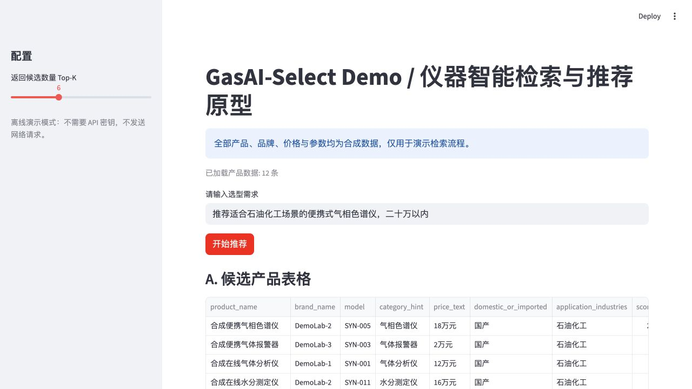

# GasAI-Select

**An offline, interactive instrument-selection demo built with Python and Streamlit.**

Describe an application in Chinese, compare ranked instruments, and inspect matching reasons and record details. All 12 bundled product records are fictional and were created specifically for this public release.



## Quick start

Requires Python 3.10 or later.

```bash
python -m venv .venv
source .venv/bin/activate
python -m pip install -r requirements.txt
streamlit run app.py
```

On Windows, activate with `.venv\Scripts\activate`. No API key, database, model download, or external service is needed. Streamlit serves the interface locally; the application makes no external model requests.

Try these queries:

- `推荐适合石油化工场景的便携式气相色谱仪，二十万以内`
- `环保场景使用的便携气体分析仪，十万以内`
- `食品实验室使用的水分测定仪`

## How it works

1. Parse instrument categories, industry, price expressions, origin, and portable/online requirements.
2. Rank records with explicit field and keyword scores, using weaker recall when few matches exist.
3. Show candidate scores, matching reasons, synthetic record identifiers, product details, and a deterministic explanation.

Budget and other constraints are **soft ranking preferences**, not guaranteed eligibility filters. Review matching reasons; lower-ranked or fallback candidates may not satisfy every condition. Chinese category and industry vocabularies are intentionally small.

This edition uses rule-based retrieval and templated explanations. It does not claim a GraphRAG implementation, trained recommendation model, validated safety reasoning, or benchmark improvements. It is a software demonstration, not procurement guidance.

## Project structure

```text
app.py                         Streamlit interface
retriever.py                   Query parsing and candidate ranking
utils.py                       Data loading, price parsing, offline explanations
data/synthetic_products.json   12 fictional records
tests/test_demo.py              Retrieval, privacy and UI interaction checks
```

## Contribution and provenance

Heng Zhang's local GasAI-Select prototype supplied the interface, retrieval, price matching, and explanation logic. This public edition retains that core, removes external API integration, replaces the private product corpus with independently constructed synthetic records, and adds release tests and documentation. The original research folder is unchanged.

No scraped product descriptions, original company records, contact names, phone numbers, credentials, database dumps, or internal research documents are included. `example.invalid` addresses are fictional identifiers, displayed as text rather than real source links.

No license is granted in this release; contact the repository owner about reuse.

## Validation

```bash
python -m unittest discover -s tests -v
```

The suite exercises Chinese budget parsing, ranking, empty results, offline behaviour, synthetic-data hygiene, and the Streamlit recommendation interaction. External model integrations are deliberately absent from this release.

Validated locally with Python 3.12 and Streamlit 1.56.0: all six tests passed, the local server started successfully, and a browser recommendation returned SYN-005 as the first candidate for the petrochemical portable gas-chromatograph example.
